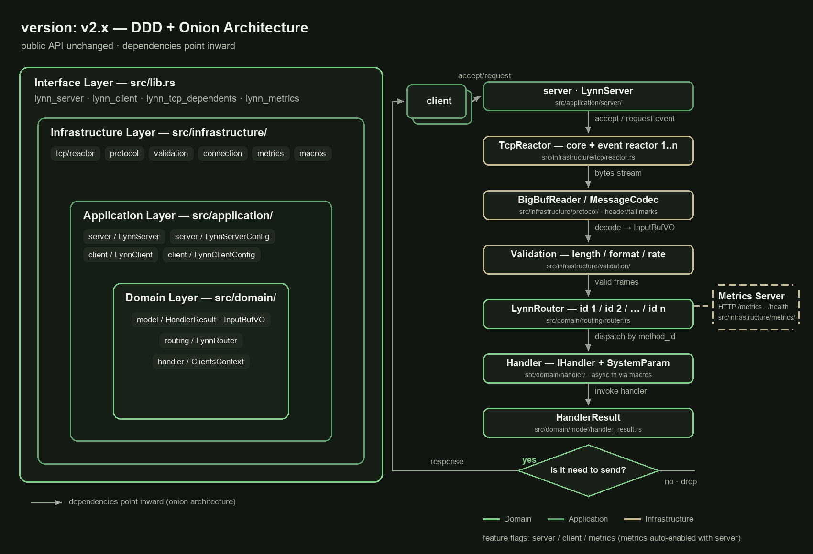
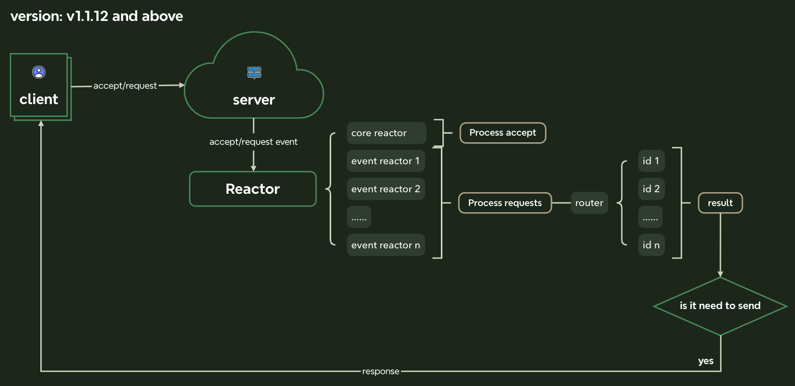

<div align="center">

<h1>Lynn_tcp</h1>
<p>
  <a href="https://github.com/cherish-ltt/lynn_tcp/actions/workflows/rust-ci.yml">
    
  </a>
  <a href="https://crates.io/crates/lynn_tcp">
    
  </a>
  <a href="https://docs.rs/lynn_tcp">
    
  </a>
  <a href="https://github.com/cherish-ltt/lynn_tcp/blob/main/LICENSE-MIT">
    
  </a>
  <a href="https://www.rust-lang.org">
    
  </a>
</p>
</div>

[English](https://github.com/cherish-ltt/lynn_tcp/blob/main/README.md) | 简体中文

**Lynn_tcp** 是基于 Tokio 构建的轻量级异步 TCP 框架，支持显式启用 KCP 传输。

采用 **DDD（领域驱动设计）+ 洋葱架构**，将核心领域逻辑与基础设施实现分离，提升可维护性和可扩展性。

### v2.4.0 - 可选 KCP 与真实传输指标

PR #89/#90 新增底层 KCP 传输、自定义 fast 配置，以及服务端连接、消息和字节自动指标。
TCP 保持默认；kcp-ovo **0.5.2** 已解除上游全局分配器及重传退避缺陷。
要求 Rust **1.99.1**，Tokio/bytes 固定为 **1.52.3/1.11.1**，包括默认 TCP 构建。
升级时删除重复的内置指标手工累加。
详见 [v2.4.0 变更日志](docs/update_logs/v2.4.0.md)、[KCP 迁移与建议场景](docs/kcp.md)
和 [指标迁移](METRICS.md)。更早版本用户仍须适配
[v2.3.0 返回类型变更](docs/update_logs/v2.3.0.md)；KCP 不代表普遍提速或安全升级。

---

### 特点

- **轻量级**: 简洁易懂的代码，快速上手
- **并发与性能**: 基于 Tokio 优秀的异步运行时，轻松实现高并发多用户连接
- **低延迟**: 读写分离设计，最小化延迟
- **安全稳定**: Rust 强类型与内存安全保障
- **生产就绪**: 内置 Prometheus 指标、连接限制、速率限制、心跳管理

> **提示**: Lynn_tcp 主要用于<u>消息转发</u>和<u>长连接 TCP 游戏服务器</u>。
>
> 基于框架快速开发业务场景 — 自定义消息解析、加密、路由等。

---

### 架构

Lynn_tcp v2.0 遵循洋葱架构，分为三个清晰层次：

```
┌─────────────────────────────────────┐
│          接口层 (Interface)          │  ← 公开 API
│   (lynn_server / lynn_client / ...) │
├─────────────────────────────────────┤
│          应用层 (Application)        │  ← 编排层：服务器/客户端启动流程
│   (LynnServer / LynnClient)         │
├─────────────────────────────────────┤
│          领域层 (Domain)             │  ← 纯业务逻辑
│   (Router / Handler / Model)        │
├─────────────────────────────────────┤
│        基础设施层 (Infrastructure)    │  ← 具体实现
│   (TCP / Metrics / Validation)      │
└─────────────────────────────────────┘
```

---

### 服务端生命周期

释放服务端或取消 `LynnServer::start()` 会取消其 worker、handler、心跳、待决握手及活跃连接。取消为异步过程，不保证请求/响应队列排空或 TLS 优雅关闭；需要确认交付的交互应在取消前完成。

TLS 连接初始化不占用业务 worker，同时进行的初始化最多为配置的 worker 数。超出握手并发限制时立即拒绝；每个握手仍持有全局/每 IP 连接许可，并保留原有 10 秒握手超时。明文 TCP 初始化路径不变。

### 快速开始

#### 依赖配置

在 `Cargo.toml` 中添加：

**默认服务端 + 客户端**（可选功能仍关闭）：

```toml
[dependencies]
lynn_tcp = "=2.4.0"
tokio = { version = "1", features = ["macros", "net", "rt-multi-thread"] }
tracing-subscriber = "0.3"
```

**仅服务器端**：

```toml
[dependencies]
lynn_tcp = { version = "=2.4.0", default-features = false, features = ["server"] }
tokio = { version = "1", features = ["macros", "net", "rt-multi-thread"] }
tracing-subscriber = "0.3"
```

**仅客户端**：

```toml
[dependencies]
lynn_tcp = { version = "=2.4.0", default-features = false, features = ["client"] }
tokio = { version = "1", features = ["macros", "net", "rt-multi-thread"] }
tracing-subscriber = "0.3"
```

`LynnServer::start().await` 返回 `lynn_tcp::Result<()>`；必须传播或处理启动错误（包括监听绑定和 TLS 初始化失败）。依赖 unit 输出的代码（如 `JoinHandle<()>`）需要适配新的返回类型。

服务端任务池至少需要一个 worker；零值在监听前返回配置错误。旧版 threadpool setter 同样受此约束，不改变其他配置中零值禁用限制的语义。

#### 最小服务器示例

```rust
use lynn_tcp::{lynn_server::*, lynn_tcp_dependents::*};

#[tokio::main]
async fn main() -> Result<(), Box<dyn std::error::Error>> {
    tracing_subscriber::fmt::init();

    LynnServer::new()
        .await
        .add_router(1, ping_handler)
        .add_router(2, echo_handler)
        .add_router(3, broadcast_handler)
        .start()
        .await?;

    Ok(())
}

pub async fn ping_handler() -> HandlerResult {
    println!("📡 收到 Ping");
    HandlerResult::new_without_send()
}

pub async fn echo_handler(input_buf_vo: InputBufVO) -> HandlerResult {
    let addr = input_buf_vo.get_input_addr().unwrap();
    println!("📨 来自: {}", addr);
    HandlerResult::new_without_send()
}

pub async fn broadcast_handler(clients_context: ClientsContext) -> HandlerResult {
    let addrs = clients_context.get_all_clients_addrs().await;
    HandlerResult::new_with_send(3, "大家好！".into(), addrs).expect("payload fits the protocol limit")
}
```

#### 自定义配置服务器

```rust
use lynn_tcp::{lynn_server::*, lynn_tcp_dependents::*};

#[tokio::main]
async fn main() -> Result<(), Box<dyn std::error::Error>> {
    tracing_subscriber::fmt::init();

    let config = LynnServerConfigBuilder::new()
        .with_addr("0.0.0.0:9876")?
        .with_server_max_connections(Some(&500))
        .with_server_max_taskpool_size(&256)
        .with_tcp_nodelay(&true)
        .with_tcp_keepalive_enabled(&true)
        .with_tcp_keepalive_time_secs(&120)
        .build();

    LynnServer::new_with_config(config)
        .await
        .add_router(1, my_handler)
        .start()
        .await?;

    Ok(())
}

pub async fn my_handler() -> HandlerResult {
    HandlerResult::new_without_send()
}
```

#### 最小客户端示例

```rust
use lynn_tcp::{
    lynn_client::LynnClient,
    lynn_tcp_dependents::*,
};

#[tokio::main]
async fn main() -> Result<(), Box<dyn std::error::Error>> {
    tracing_subscriber::fmt::init();

    let mut client = LynnClient::new_with_addr("127.0.0.1:9177")
            .await
            .start()
            .await;

    // 发送消息
    client.send_data(
        HandlerResult::new_with_send_to_server(1, "你好".into())?
    ).await?;

    // 接收响应
    if let Some(response) = client.get_receive_data().await {
        println!("收到响应: {:?}", response.get_all_bytes());
    }

    Ok(())
}
```

---

### 示例

所有示例位于 [`examples/`](examples/) 目录。使用以下命令运行：

| 示例 | 命令 | 说明 |
|------|------|------|
| `basic_server` | `cargo run --example basic_server` | 默认配置服务器，展示 3 种 Handler 签名 |
| `custom_config_server` | `cargo run --example custom_config_server` | 通过 Builder 自定义服务器配置 |
| `custom_protocol` | `cargo run --example custom_protocol` | 自定义消息头尾标记 |
| `echo_server_client` | `cargo run --example echo_server_client` | **完整请求-响应循环**（客户端 ↔ 服务器双向通信） |
| `multi_route_service` | `cargo run --example multi_route_service` | **多路由分发与验证** |
| `custom_protocol_full` | `cargo run --example custom_protocol_full` | 自定义协议客户端配套 |
| `state_example` | `cargo run --example state_example` | **全局状态注入**（`AppState<T>`） |
| `tls_example` | `cargo run --example tls_example --features tls` | **TLS 1.3 加密**服务器 ↔ 客户端 |
| `metrics_example` | `cargo run --example metrics_example --features metrics` | Prometheus 指标集成演示 |

建议从 **`echo_server_client`** 和 **`multi_route_service`** 入手，它们最能展示客户端 ↔ 服务器的通信模式。

---

### 特性

| 特性 | 说明 | 默认启用 |
|------|------|---------|
| `server` | TCP 服务器，支持多路由异步 Handler、心跳、连接管理 | ✅ |
| `client` | TCP 客户端，支持消息收发与断线自动重连 | ✅ |
| `metrics` | Prometheus 集成（17 个生产级指标，HTTP /metrics 端点） | ✅（由 `server` 启用） |
| `kcp` | 基于 kcp-ovo 0.5.2 的可选明文 UDP/KCP 传输 | 默认关闭 |
| `tls` | 服务端与客户端 TLS 1.3 传输加密（rustls/ring） | ❌ 按需开启 |
| `seaorm` | 内置 SeaORM 支持：`with_db(...)` + `DbConn` 数据库句柄 | ❌ 按需开启 |

> **注意**: 选择 `server` 特性时 `metrics` 会自动启用。单独使用：`default-features = false, features = ["metrics"]`。`tls` 与 `seaorm` 默认关闭，必须显式启用。

`client` 与 `server` 可独立编译，也可分别搭配 `tls`。未启用任何 feature 时，crate 仍可构建，但不提供两种传输 API。示例、集成测试及基准目标须启用其声明的角色；CI 检查并测试无 feature、仅客户端、仅服务端、仅 metrics、客户端+TLS、服务端+TLS 六种配置。

metrics HTTP 端点支持 `/metrics` 和 `/health` 请求行跨 TCP 分片到达。
请求行必须在 1024 字节内以 CRLF 结束，并在 5 秒内收齐；超长或不完整的请求会关闭连接。
未知路径仍返回 HTTP 404。

---

### 自动传输指标

启用 `server` 后，框架自动采集服务端接受连接、活跃/关闭/初始化失败连接、
已解析帧、完成写入的响应、帧大小和 handler 耗时。字节计数反映服务端成功的
帧读写（含部分写入和帧头尾），不含 TLS 握手、加密开销和 TCP 重传；客户端
与指标 HTTP 监听器不计入这些计数。

升级时删除对上述内置指标的手工增量，业务事件使用独立指标名称。进程内存、
线程、队列长度和 OS 重传仍需外部或手工采集。精确边界、取消限制及迁移见
[METRICS.md](METRICS.md)。

### 可配置项（LynnServerConfigBuilder）

| 方法 | 说明 | 默认值 |
|------|------|--------|
| `with_addr()` | 服务器监听地址 | `0.0.0.0:9177` |
| `with_server_max_connections()` | 已接受连接总上限，包含排队、TLS 握手与在线会话（`None` = 不限制） | `100_000` |
| `with_server_max_taskpool_size()` | 异步任务池大小（吞吐量） | `512` |
| `with_server_single_process_permit()` | 每连接排队及执行中的请求上限（0=拒绝请求） | `14` |
| `with_server_check_heart_interval()` | 心跳检测间隔（秒） | `60` |
| `with_server_check_heart_timeout_time()` | 心跳超时时间（秒） | `180` |
| `with_tcp_nodelay()` | TCP_NODELAY（禁用 Nagle 算法） | `true` |
| `with_tcp_keepalive_enabled()` | TCP 保活 | `true` |
| `with_tcp_keepalive_time_secs()` | 保活间隔（秒） | `120` |
| `with_message_header_mark()` | 自定义消息头标记 | `0x23D9` |
| `with_message_tail_mark()` | 自定义消息尾标记 | `0x1E27` |
| `with_max_connections_per_ip()` | 每 IP 活跃连接上限（0=禁用） | `10` |
| `with_connection_rate_limit()` | 连接速率限制（每秒，0=禁用） | `0` |
| `with_read_timeout_secs()` | 读取空闲超时（秒，0=禁用） | `0` |
| `with_write_timeout_secs()` | 单次响应写入及关闭超时（秒，0=禁用） | `0` |
| `with_recv_buffer_size()` | 接收缓冲区（字节） | `65535` |
| `with_send_buffer_size()` | 发送缓冲区（字节） | `65535` |
| `with_tls()` *（feature `tls`）* | 使用 `TlsServerConfig` 开启 TLS 1.3 | 关闭 |
| `with_tls_cert_paths()` *（feature `tls`）* | 从 PEM 证书/私钥路径开启 TLS 1.3 | 关闭 |

Reactor worker 的空闲退避有上限，计数不会溢出回绕；长时间空闲后收到任务仍会恢复处理。

I/O 超时适用于明文 TCP 和握手后的 TLS。每次收到字节都会重置读取空闲期限，
因此它不是完整帧的总时限。写入期限覆盖单次响应及其刷新，最终关闭另计期限。
超时后关闭连接并回收配额；已部分写出的响应不会重试。
每次响应均刷新，包括 TLS 小响应；零值禁用期限，不禁用刷新。

### 可配置项（LynnClientConfigBuilder）

| 方法 | 说明 | 默认值 |
|------|------|--------|
| `with_server_addr()` | 要连接的服务器地址 | — |
| `with_server_single_channel_size()` | 单连接通道容量 | `64` |
| `with_server_check_heart_interval()` | 心跳发送间隔（秒） | `5` |
| `with_message_header_mark()` / `with_message_tail_mark()` | 自定义消息标记 | `9177` / `7719` |
| `with_reconnect_max_attempts()` | 每轮连接尝试次数（初始连接与每次重连） | `3` |
| `with_reconnect_interval_secs()` | 两次尝试的间隔（秒） | `1` |
| `with_connect_timeout_secs()` | 单次连接/TLS 握手超时（秒） | `3` |
| `with_tls()` *（feature `tls`）* | 使用 `TlsClientConfig` 开启 TLS 1.3（CA、SNI、mTLS） | 关闭 |

客户端逐帧刷新，TLS 背压解除后最后一条请求不必等待后续消息或心跳。
写入或刷新失败会结束连接，不重试可能已部分发送的帧；释放客户端仍可取消阻塞中的刷新。

首次连接立即尝试；连接失败或已建立连接结束后均等待配置的重连间隔，
包括对端接受后立即关闭的情况。零值显式禁用等待，释放客户端会取消等待。

---

### TCP 或 KCP

TCP 保持默认。启用 `kcp` 后，分别使用
`LynnServerConfigBuilder::with_kcp(KcpConfig::default())` 和
`LynnClientConfigBuilder::with_kcp(KcpConfig::default())`，配置类型从
`lynn_tcp::lynn_kcp::KcpConfig` 导入。两端复用相同 handler、帧协议、路由和状态；
单个实例只监听一种传输。

适配始终使用**底层 Kcp 控制块**，不使用上游高阶 Stream/Listener API。
`KcpConfig::default()` 为自定义 **fast**：
`nodelay=true, interval=10, fastresend=2, nocwnd=true`；新数据和 ACK 立即输出，
不等待定时 tick。`KcpConfig::normal_mode()` 使用上游 normal 预设
（false/100/0/false）。通过 `KcpConfig::protocol` 和重导出的 `KcpOptions`
自定义底层参数。

消息/流模式与 fast/normal 独立。本适配的 HELLO/DATA/EOF 封装要求**消息模式**，
显式拒绝 `stream_mode=true`，但框架仍使用字节流。fast 关闭拥塞窗口控制，
不关闭对端窗口或队列上限，可能降低网络公平性。详见 [配置与迁移](docs/kcp.md)
和 [当前性能实测](docs/kcp-v0.5.2-validation.md)（含 10%/20%/30% 丢包研究及验收总结），
不承诺等同 TCP。

**按场景选择：**回环/局域网、大流量吞吐或低丢包优先 TCP，需要认证和加密时使用 TCP+TLS。
延迟敏感的小消息、受控且有丢包的 UDP 链路可以评估 KCP fast，但须先验证目标网络。
合入前 128 B、32 并发实测：20 ms RTT 无丢包为 TCP 的 94.5%，10%/20%/30%
丢包为 TCP 的 2.21/4.40/7.42 倍；纯回环仅 29.9%。这是发布前数据，不是 SLA 保证。
Normal 是保守对照预设，不代表已证明更快或适合生产。

```sh
cargo run --example kcp_echo --features kcp
# 独立客户端：default-features = false, features = ["client", "kcp"]
# 独立服务端：default-features = false, features = ["server", "kcp"]
LYNN_BENCH_TRANSPORT=kcp cargo bench --features kcp --bench benchmark -- --model 1 --clients 32,128
```

KCP **不加密、不认证**，不等价于 TLS，也不兼容标准 KCP 线路协议。本适配使用
kcp-ovo 的 28 字节大端头及 Lynn 会话握手/封装，两端均须使用本适配。
TCP+TLS 保留；TLS 与 KCP 同时配置会拒绝启动，不静默降级。

`KcpConfig::idle_timeout_secs` 默认 60，必须非零。Drop/abort 异步取消并丢弃排队
数据；UDP 对端消失后通过空闲超时回收，不保证立即发现。帧保留现有 10 MiB body
上限，拆分为有界 KCP 消息。`send_data` 表示本地入队，KCP flush 等待传输 ACK，
**不代表业务交付**；释放 owner 前应完成应用层确认交互。

现要求 Rust **1.99.1**。为兼容上游精确约束，Tokio/bytes 锁定为
**1.52.3/1.11.1**（包括默认 TCP 构建）。锁定的 kcp-ovo **0.5.2** 已修复全局分配器冲突
（[#36](https://github.com/cherish-ltt/kcp-ovo/issues/36)）与超时退避/重传期限
（[#38](https://github.com/cherish-ltt/kcp-ovo/issues/38)），支持应用自选全局分配器。
上游仍启用 Tokio `full`；底层适配与自定义 fast 配置不变。
回归结果与同条件 TCP/KCP 实测见 [0.5.2 复测](docs/kcp-v0.5.2-validation.md)，
历史 0.5.0 数据按版本独立保留。KCP 默认关闭，不承诺更快。
生命周期、内存边界、指标、安全、互操作与测试见 [KCP 传输契约](docs/kcp.md)。

### TLS 1.3 传输加密（feature `tls`）

TLS **默认关闭**。启用 `tls` feature 并配置证书即手动开启 —— 仅支持 TLS 1.3（rustls + ring）：

```toml
[dependencies]
lynn_tcp = { version = "=2.4.0", features = ["tls"] }
```

```rust
use lynn_tcp::{lynn_server::*, lynn_tcp_dependents::*, lynn_tls::*};

// 服务端：配置证书链 + 私钥（PEM 文件）即开启。
let config = LynnServerConfigBuilder::new()
    .with_addr("0.0.0.0:9177")?
    .with_tls_cert_paths("cert.pem", "key.pem") // 或：.with_tls(TlsServerConfig::new(...))
    .build();
// 双向 mTLS：TlsServerConfig::new("cert.pem", "key.pem").with_client_ca("client_ca.pem")
```

```rust
use lynn_tcp::{lynn_client::*, lynn_tls::*};

// 客户端：通过 CA 信任锚校验服务器证书。
let config = LynnClientConfigBuilder::new()
    .with_server_addr("127.0.0.1:9177")?
    .with_tls(
        TlsClientConfigBuilder::new()
            .with_ca_cert_path("ca.pem")
            .with_server_name("localhost") // 可选的 SNI 覆盖
            .build(),
    )
    .build();
```

TLS 配置错误（文件缺失、证书私钥不配对）会在启动时立即报错；握手失败的连接会被直接关闭。可运行演示：`cargo run --example tls_example --features tls`。

显式配置的 mTLS 客户端身份在仅供开发的 `danger_accept_invalid_certs` 模式下仍会保留。
客户端证书与私钥必须同时提供；残缺或无效身份会使配置失败，不会静默关闭 mTLS。

未设置 `with_server_name` 时，证书名称校验使用服务器的 IPv4 或 IPv6 地址
（例如 `[::1]:9177` 需要证书包含 `::1` IP SAN）。显式服务器名称优先，默认仍校验 CA 信任及证书名称。

---

### 全局状态（依赖注入）

通过 `with_state` 注册任意 `Send + Sync + 'static` 的共享值（如数据库句柄），Handler 参数声明 `AppState<T>` 即自动装配（类似 axum 的 State）。每个类型一个值，多个类型可共存。SeaORM 用户启用 `seaorm` feature 后可用 `with_db(...)` + `DbConn`：

```rust
use lynn_tcp::{lynn_server::*, lynn_tcp_dependents::*, lynn_state::AppState};

#[tokio::main]
async fn main() -> lynn_tcp::Result<()> {
    LynnServer::new()
        .await
        .with_state(UserRepo::new()) // seaorm feature 下也可：.with_db(db)
        .add_router(1, find_user)
        .start()
        .await
}

// `repo` 直接解引用为 &UserRepo —— 无全局静态、无需手动传递 Arc。
async fn find_user(repo: AppState<UserRepo>, input: InputBufVO) -> HandlerResult {
    let name = repo.find_user(42);
    HandlerResult::new_with_send(1, name.into(), vec![input.get_input_addr().unwrap()]).expect("payload fits the protocol limit")
}
```

状态在请求处理时解析，因此 `with_state` 可以在 `add_router` 之前或之后调用 —— 只需在 `start()` 前注册即可。可运行演示：`cargo run --example state_example`。

---

#### 接收协议错误

自定义帧头和帧尾标记属于各服务端实例，同时用于请求解析与响应编码；不同标记的服务端可在同一进程同时或先后运行，不共享协议配置。

`InputBufVOTrait::next_str_with_len` 支持空字符串和短字符串字段，成功时只消费指定字节数，长度超限或越界时不移动游标；字段长度不受完整帧的元数据最小长度限制。

`HandlerResult::new_with_send` 和 `new_with_send_to_server` 现在返回 `lynn_tcp::Result<HandlerResult>`；payload 超过 **10 MiB 减 5 字节**时，在分配完整帧或入队前返回 `LynnError::Protocol`，同样覆盖直接使用 `get_sender()` 和服务端广播的路径。请用 `?` 或 `match` 处理构造错误；拒绝本地超限消息不会关闭已有连接。这是构造器返回类型变更，调用方需要适配；`new_without_send` 与心跳行为不变，入队成功仍不代表交付成功。

客户端与服务端会拒绝错误的帧头、长度和帧尾，并关闭对应传输连接（包括 TLS）；正常分片与粘包仍受支持。接收解析器最多保留 10 MiB 帧上限、10 字节帧头及一次 1 KiB socket 读取的数据；终止性解析错误会释放缓存并拒绝后续输入。这是单解析器的数据保留上限，不是进程级内存配额。客户端在协议错误后仍遵循已配置的重连策略。

### 客户端断线自动重连

服务端在断线、传输错误、心跳驱逐或 TLS 握手失败后归还连接配额。读取 EOF 后先完成已接收的处理任务并发送其响应，再关闭写半部；无响应会话仍受心跳驱逐约束。处理许可覆盖请求排队、执行直至响应入队，超限请求被拒绝并记录告警，不再无界排队。

客户端内置连接监督者：连接断开后自动重连 —— **默认尝试 3 次**，间隔 1 秒（均可配置）。用户侧收发通道跨重连复用，断线期间积压的过期帧会被丢弃，连接状态可随时查询：

```rust
let mut client = LynnClient::new_with_addr("127.0.0.1:9177").await.start().await;
if !client.is_connected() {
    eprintln!("服务器不可达");
}
```

释放 `LynnClient` 会取消连接、读写、重试及心跳任务。`get_sender()` 克隆出的句柄不会延长客户端生命周期，并将进入关闭状态。取消异步完成，不保证发送完队列中的消息或发送 TLS `close_notify`；必须完成的交互应在释放 owner 前结束。

---

### 规划

#### ✅ 已完成核心功能（v1.0.0+）

- ✅ TCP 服务器，支持多路由异步 Handler 分发
- ✅ TCP 客户端，支持消息收发
- ✅ 自定义消息头尾标记
- ✅ 客户端心跳检测与自动清理
- ✅ 异步任务路由服务
- ✅ Prometheus + Grafana 监控集成（v1.2.5）
- ✅ DDD + 洋葱架构重构（v2.0.0）
- ✅ 7 个可运行示例覆盖所有场景
- ✅ 服务端与客户端 TLS 1.3 传输加密（v2.0.0）
- ✅ 客户端自动断线重连，尝试次数可配置（v2.0.0）
- ✅ 全局状态注入（`AppState<T>`）+ 内置 SeaORM 支持（v2.0.0）

#### 🔜 计划中

| 功能 | 目标版本 | 状态 |
|------|---------|------|
| 中间件支持 | 待定 | 📝 设计中 |
| 定时任务 | 待定 | 💡 构思中 |

---

### 流程图

**v2.x — DDD + 洋葱架构**

[](https://github.com/cherish-ltt/lynn_tcp/blob/main/docs/FlowChart-v2.png?raw=true)

<details>
<summary>v1.x 架构（历史版本）</summary>

[](https://github.com/cherish-ltt/lynn_tcp/blob/main/docs/FlowChart.png?raw=true)

</details>

---

### 版本介绍

查看完整版本历史：[docs/version.md](https://github.com/cherish-ltt/lynn_tcp/blob/main/docs/version.md)，各版本更新日志见 [docs/update_logs/](https://github.com/cherish-ltt/lynn_tcp/tree/main/docs/update_logs)。

---

### 基准测试

自 v2.0.0-rc.3 起，Lynn_tcp 内置**标准化、可复用的基准测试工具**（`benches/benchmark.rs` + 独立的 `bench_echo_server` 二进制）。服务器以独立进程运行（与真实部署一致），每个并发梯度都从全新 server 进程开始，每格先预热（不计入）再测量固定窗口。2.0 之前的表格由无法恢复的一次性脚本产生，已全部退役。

**流量模型**

- **Model 1 — 请求/响应（ping-pong）**：每个客户端同时只保留 1 个在途请求，逐次测量往返时延；输出吞吐量与 RTT 分位数。
- **Model 2 — 收发并发（流水线）**：每个客户端运行发送与接收两个任务，在途窗口固定（8）；输出持续吞吐量。

**标准矩阵**：模型 1+2 × 客户端并发 64 / 256 / 1024 / 4096（对数 4× 步长，覆盖延迟主导与吞吐饱和两个区间），回显载荷 128 B，每格 3s 预热 + 10s 测量。

**复现方式**

```bash
cargo bench --bench benchmark -- --json results.json
# 自定义：--model all|1|2  --clients 64,256  --duration 15  --warmup 3  --payload 128
```

**新版本 / 新机型的标准跑法（维护者）**

```bash
git pull && cargo bench --bench benchmark -- --json docs/benchmark/v<版本>-<机型>.json
```

运行前确认文件描述符上限能满足最高并发档位（`ulimit -n 65535`；基准启动时也会自动提升至硬上限）。跑完后将 JSON 存档到 `docs/benchmark/`（命名 `v<版本>-<机型>.json`），并在**同一提交**中更新两份 README 的结果表（见 [AGENTS.md](AGENTS.md) §10.3）。

<details>
<summary>结果 — Apple M1 Pro（8 逻辑核：6 性能核 + 2 能效核，16 GB）、macOS、回环 — 2026.09.05</summary>

[原始 JSON](docs/benchmark/v2.0.0-rc.3-apple-m1-pro.json)

| 模型 | 客户端 | 载荷 (B) | 吞吐 (resp/s) | 平均 RTT (ms) | p50 (ms) | p95 (ms) | p99 (ms) |
|:-----|-------:|---------:|--------------:|--------------:|---------:|---------:|---------:|
| 1 (ping-pong) | 64   | 128 | **135,473** | 0.472 | 0.439 | 0.791 | 1.046 |
| 1 (ping-pong) | 256  | 128 | **142,735** | 1.793 | 1.634 | 3.295 | 4.435 |
| 1 (ping-pong) | 1024 | 128 | **147,568** | 6.938 | 5.827 | 15.200 | 22.410 |
| 1 (ping-pong) | 4096 | 128 | **138,073** | 29.640 | 28.416 | 35.220 | 64.218 |
| 2 (流水线)    | 64   | 128 | **151,644** | — | — | — | — |
| 2 (流水线)    | 256  | 128 | **191,607** | — | — | — | — |
| 2 (流水线)    | 1024 | 128 | **143,569** | — | — | — | — |
| 2 (流水线)    | 4096 | 128 | **31,956** | — | — | — | — |

> 📊 以上为回环单机数据：压测客户端与服务器共享 CPU，请将其作为版本间的相对对比，而非绝对容量。Model-1 的 RTT 随并发增长（典型的排队效应）。Model-2 在本机约 256 客户端处达到峰值；其 4096 档受建连阶段重试影响（见 JSON 中 requests ≫ responses 的缺口），该点应读作下界而非稳态。

</details>

<details>
<summary>结果 — Debian 13，arm64（2 核 / 2 GB）、回环 — 2026.09.05</summary>

[原始 JSON](docs/benchmark/v2.0.0-rc.3-arm64-2c2g-debian13.json)

| 模型 | 客户端 | 载荷 (B) | 吞吐 (resp/s) | 平均 RTT (ms) | p50 (ms) | p95 (ms) | p99 (ms) |
|:-----|-------:|---------:|--------------:|--------------:|---------:|---------:|---------:|
| 1 (ping-pong) | 64   | 128 | **128,206** | 0.499 | 0.232 | 0.988 | 5.099 |
| 1 (ping-pong) | 256  | 128 | **140,197** | 1.826 | 0.835 | 3.504 | 35.898 |
| 1 (ping-pong) | 1024 | 128 | **140,187** | 7.303 | 2.602 | 45.081 | 55.153 |
| 1 (ping-pong) | 4096 | 128 | **130,003** | 31.445 | 6.305 | 111.846 | 167.948 |
| 2 (流水线)    | 64   | 128 | **35,277** | — | — | — | — |
| 2 (流水线)    | 256  | 128 | **142,922** | — | — | — | — |
| 2 (流水线)    | 1024 | 128 | **360,433** | — | — | — | — |
| 2 (流水线)    | 4096 | 128 | **7,125** | — | — | — | — |

> 📊 值得注意：仅用两个核心，Model-1 吞吐从 64 到 4096 客户端几乎持平（128k~140k），但排队形成后 RTT 尾部急剧增长。Model-2 在 1024 并发冲到 360k，但 4096 档崩塌（7,125 resp/s，建连阶段重试）——2 GB 内存主机上该档位受内存约束（内核 socket 缓冲 + 连接状态），应读作主机资源上限而非框架回退。

</details>

<details>
<summary>与 v1.1.x / v1.2.x 的模糊比对（测试工具与硬件均不同，仅看趋势）</summary>

> v1.x 数据来自已无法恢复的一次性脚本（Debian 12，4 核 4G 服务器）；v2.0 数据来自上方标准化工具（Apple M1 Pro，8 逻辑核 / 16 GB）。硬件、操作系统与方法论均不同，请将下表作为趋势参考而非绝对结论。

**Model 1 — 请求/响应（resp/s）**

| 并发 | v1.1.x | v1.2.x | v2.0.0-rc.3 |
|-----:|-------:|-------:|------------:|
| 256  | 182,879 | 64,630 | **142,735** |
| 1024 | 232,861 | 163,307 | **147,568** |
| 4096 | 160,318 | 124,645 | **138,073** |

**Model 2 — 收发并发（resp/s）**

| 并发 | v1.1.x | v1.2.x | v2.0.0-rc.3 |
|-----:|-------:|-------:|------------:|
| 256  | 80,499 | 492,889 | **191,607** |
| 1024 | 23,143 | 158,056 | **143,569** |
| 4096 | 13,557 | 52,163 | **31,956** |

**结论**

- Model-1 与 v1.x 保持同一量级，无可辨认的回退，且 4096 档衰减最小（峰值→4096：−6%，v1.x 为 −36% / −32%）。
- Model-2 在 1024 并发内保持 143k~192k，而 v1.1.x 同并发已塌至 23k（6.2 倍）；其 4096 档在本次记录中受建连阶段重试影响（JSON 中 requests ≫ responses），应读作下界，v1.x 该档数据来自无界突发，不可直接比较。
- Model-2 语义存在差异（v1.x 疑似无在途限制的突发；v2.0 为固定 8 深流水线），该表仅作方向性参考。
- v2.0 额外提供 RTT 分位数，v1.x 从未测量过。

</details>

---

### 常见问题

**问: v2.0.0 向后兼容 v1.x 吗？**

答: 是的。所有公共 API 签名保持不变。只需更新 `Cargo.toml` 中的版本号：`lynn_tcp = "2"`。

**问: 升级后需要修改代码吗？**

答: 不需要。重构完全是结构性的，没有修改任何行为。现有代码可以直接编译运行。

**问: 为什么从 v1.2.x 直接跳到 v2.0.0？**

答: DDD + 洋葱架构重构代表了重大的架构改进。尽管公共 API 完全兼容，但大版本号提升反映了这次变更的深度。

**问: 如何运行示例？**

答: 参见上方的[示例](#示例)表格。每个示例都可以通过 `cargo run --example <名称>` 运行。

**问: 如何启用指标监控？**

答: `server` 特性会自动启用 `metrics`。运行指标示例：`cargo run --example metrics_example --features metrics`。详细文档见 [METRICS.md](METRICS.md)。

**问: 如何启用 TLS？**

答: 启用 `tls` feature，服务端 Builder 调用 `.with_tls_cert_paths("cert.pem", "key.pem")`、客户端 Builder 调用 `.with_tls(...)` —— 仅支持 TLS 1.3，默认关闭。参见 [TLS 1.3 传输加密](#tls-13-传输加密feature-tls)。

**问: 如何让 Handler 访问数据库句柄？**

答: 在 `LynnServer` 上调用 `.with_state(db)`（`seaorm` feature 下也可用 `.with_db(db)`），Handler 声明 `AppState<T>` 参数即可。参见[全局状态](#全局状态依赖注入)。

**问: 客户端会自动重连吗？**

答: 会。断线后默认自动重试 3 次（间隔 1 秒），可通过 `with_reconnect_max_attempts` / `with_reconnect_interval_secs` 配置；用 `client.is_connected()` 实时查询连接状态。

---

### 开源协议

本项目采用双许可，您可任选其一：

- MIT 协议（[LICENSE-MIT](LICENSE-MIT)）
- Apache License, Version 2.0（[LICENSE-APACHE](LICENSE-APACHE)）

### 关于贡献

- 运行 `prek run --all-files` 并处理全部 warning 与 error。章节注释使用普通标题，保留的 Clippy 抑制必须提供 `reason`。

- 提交前请先阅读 [AGENTS.md](AGENTS.md) —— 它是本项目的"开发宪法"，定义了提交规范、CI 标准、格式化与 lint 规则、测试要求（`cargo-llvm-cov` 覆盖率 ≥ 80%）以及发布流程。所有 pull request 与代码审查均参照其执行。
- 提交前请在本地运行：`cargo fmt --all`、`cargo clippy --all-targets -- -D warnings`、`cargo test`。
- 修改文档时请保持 `README.md` 与 `README_ZH.md` 同步。

除非您另有明确说明，否则您有意提交以包含在 Lynn_tcp 中的任何贡献都应被许可为 MIT OR Apache-2.0，无需任何额外的条款或条件。
